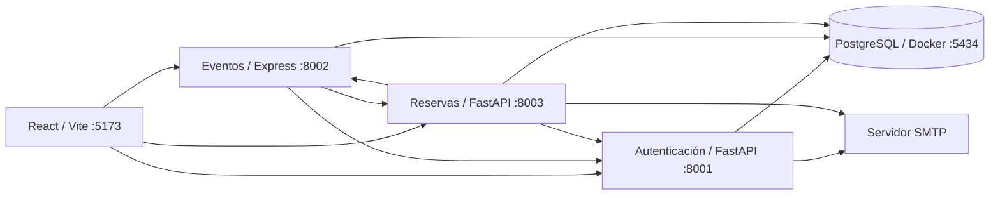

# CONCIERTA — Sistema de gestión de reservas de conciertos

**CONCIERTA** es una aplicación web académica para administrar conciertos y reservar localidades de un escenario, con un frontend en React y tres microservicios independientes. La interfaz está en español, los importes se expresan en dólares estadounidenses (USD) y las fechas se presentan en horario de Ecuador (`America/Guayaquil`). **Los pagos son simulados; el sistema no procesa cargos bancarios ni emite facturas fiscales.**

## Funcionalidades

- **Clientes:** registro con credenciales temporales enviadas por SMTP; inicio de sesión; cambio obligatorio de contraseña; búsqueda de conciertos; selección de asientos y localidades sin numeración; reserva temporal; confirmación de pago simulado; historial; descarga de comprobante PDF y boletos PDF con QR; cancelación y reintento de correo fallido.
- **Administradores:** gestión de usuarios y roles; creación, edición, despublicación y republicación de conciertos; reportes con filtros por fechas, evento y estado; consulta de capacidad, ocupación, disponibilidad e ingresos simulados por evento y sección; consulta de reservas y boletos por usuario; validación de entradas mediante QR y prevención de doble uso.
- **Seguridad:** JWT firmado, roles y permisos verificados en servidor, comprobación del estado actual de las cuentas entre microservicios, invalidación de sesiones mediante `token_version`, contraseñas almacenadas con bcrypt, validación de entradas y auditoría persistente de operaciones relevantes.

## Arquitectura

| Componente | Tecnología | Puerto local | Base de datos |
|---|---|---:|---|
| Frontend | React 18 + Vite | 5173 | — |
| Autenticación | Python + FastAPI + SQLAlchemy | 8001 | `concierta_auth` |
| Eventos | Node.js + Express + Sequelize | 8002 | `concierta_events` |
| Reservas | Python + FastAPI + SQLAlchemy | 8003 | `concierta_reservations` |
| PostgreSQL | Docker / Docker Compose | 5434 (anfitrión) | Tres bases independientes |

Los servicios de aplicación se ejecutan **localmente**; Docker se utiliza para PostgreSQL. Los servicios se comunican mediante HTTP/REST y utilizan identificadores para relacionar entidades entre bases. No existen claves foráneas entre las tres bases independientes.



El diagrama es conceptual: cada microservicio accede exclusivamente a **su propia base de datos**, aunque las tres residan en la misma instancia PostgreSQL. Los detalles de relaciones y flujos se documentan en [`docs/ARQUITECTURA.md`](docs/ARQUITECTURA.md) y [`docs/DIAGRAMAS.md`](docs/DIAGRAMAS.md).

## Requisitos para Windows

- Windows con PowerShell y Docker Desktop / Docker Compose.
- **Python 3.10 o superior** compatible con las dependencias del proyecto (las pruebas locales se ejecutaron con Python 3.10.2).
- Node.js y npm (el servicio de Eventos se comprobó con Node.js 24; conviene usar una versión LTS compatible).
- Puertos libres: **5173, 8001, 8002, 8003 y 5434**.
- Una cuenta de correo SMTP configurada para el envío real de credenciales y confirmaciones.

## Instalación inicial en Windows (PowerShell)

Ejecuta los comandos **desde la carpeta raíz `CONCIERTA`**; no copies los prefijos `PS>` ni los símbolos `>>` que muestra PowerShell.

### 1. Configurar las variables de entorno

Si existe el archivo de ejemplo, cópialo antes de editar:

```powershell
Copy-Item .env.example .env
```

Configura el archivo `.env` de la raíz con tus propios valores. Las variables presentes en esta instalación son:

| Grupo | Variables |
|---|---|
| PostgreSQL | `DATABASE_HOST`, `DATABASE_PORT`, `DATABASE_USER`, `DATABASE_PASSWORD` |
| Seguridad | `JWT_SECRET`, `INTERNAL_SECRET` |
| Comunicación | `AUTH_URL`, `EVENTS_URL`, `RESERVATIONS_URL`, `CORS_ORIGIN` |
| Reservas | `HOLD_MINUTES` |
| Administrador inicial | `ADMIN_EMAIL`, `ADMIN_PASSWORD` |
| Correo | `MAIL_MODE`, `SMTP_HOST`, `SMTP_PORT`, `SMTP_SECURE`, `SMTP_USER`, `SMTP_APP_PASSWORD`, `SMTP_FROM` |

`JWT_SECRET` e `INTERNAL_SECRET` deben estar definidos y tener **al menos 32 caracteres**. La contraseña inicial del administrador se toma de `ADMIN_PASSWORD` **durante la creación inicial** de esa cuenta: cambiar el `.env` posteriormente no restablece una contraseña existente.

### 2. Iniciar PostgreSQL

Con Docker Desktop funcionando:

```powershell
docker compose up -d postgres
```

La configuración actual utiliza PostgreSQL por el puerto `5434` del equipo anfitrión. La primera inicialización debe crear las tres bases de datos del sistema mediante la infraestructura del proyecto.

### 3. Instalar dependencias Python

```powershell
python -m venv .\services\auth\.venv
.\services\auth\.venv\Scripts\python.exe -m pip install -r .\services\auth\requirements.txt

python -m venv .\services\reservations\.venv
.\services\reservations\.venv\Scripts\python.exe -m pip install -r .\services\reservations\requirements.txt
```

### 4. Instalar dependencias Node.js

```powershell
Push-Location .\services\events
npm install
Pop-Location

Push-Location .\frontend
npm install
Pop-Location
```

### 5. Iniciar los cuatro componentes

Abre **cuatro ventanas de PowerShell**, cada una situada en la raíz de CONCIERTA, y ejecuta un script distinto:

| Ventana | Comando | Comprobación |
|---|---|---|
| 1 | `.\scripts\start-auth.bat` | http://localhost:8001/health |
| 2 | `.\scripts\start-events.bat` | http://localhost:8002/health |
| 3 | `.\scripts\start-reservations.bat` | http://localhost:8003/health |
| 4 | `.\scripts\start-web.bat` | http://localhost:5173 |

Los archivos `.bat` cambian automáticamente a la carpeta del componente y arrancan:

- `start-auth.bat`: activa `services/auth/.venv` y ejecuta `uvicorn app.main:app --reload --port 8001`.
- `start-events.bat`: ejecuta `npm run dev` en `services/events`.
- `start-reservations.bat`: activa `services/reservations/.venv` y ejecuta `uvicorn app.main:app --reload --port 8003`.
- `start-web.bat`: ejecuta `npm run dev` en `frontend`.

Se incluyen scripts `.sh` equivalentes para entornos Unix; esta guía describe específicamente el flujo probado en Windows.

## Estructura principal del repositorio

Tras la refactorización modular, los cuatro componentes mantienen sus tecnologías, puertos y contratos REST. El código se organiza por responsabilidades, para separar las rutas HTTP de la seguridad, las validaciones, el acceso a datos y la lógica de negocio.

```text
CONCIERTA/
├── .env.example                 # Plantilla pública; no publicar .env
├── docker-compose.yml
├── README.md
├── frontend/
│   └── src/
│       ├── main.jsx            # Punto de entrada React
│       ├── App.jsx             # Estado y navegación
│       ├── lib/api.js          # Clientes de las API
│       ├── components/         # Mapa de localidades y componentes QR
│       └── pages/              # Pantallas de cliente y administración
├── services/
│   ├── auth/
│   │   ├── app/main.py         # FastAPI, ciclo de vida y routers
│   │   └── app/
│   │       ├── api/            # Rutas de acceso, usuarios, roles e internas
│   │       ├── core/           # Configuración y seguridad
│   │       ├── db/             # Conexión e inicialización
│   │       ├── models/         # Entidades SQLAlchemy
│   │       ├── schemas/        # DTO y validaciones Pydantic
│   │       └── services/       # Usuarios, sesiones, correo y auditoría
│   ├── events/
│   │   └── src/
│   │       ├── server.js       # Punto de arranque Express
│   │       ├── app.js          # Aplicación y configuración de rutas
│   │       ├── config/         # Variables de entorno
│   │       ├── db/             # Conexión Sequelize
│   │       ├── models/         # Modelos y relaciones
│   │       ├── routes/         # Escenario, eventos y reportes
│   │       ├── middleware/     # Autorización, errores y solicitudes
│   │       ├── services/       # Auditoría y carga de semilla
│   │       └── validation.js   # Validación de eventos
│   └── reservations/
│       ├── app/main.py         # FastAPI y ciclo de vida
│       ├── app/documents.py    # Generación de documentos y correo
│       └── app/
│           ├── api/            # Disponibilidad, reservas, tickets y reportes
│           ├── core/           # Configuración y seguridad
│           ├── db/             # Persistencia y conexión
│           ├── models/         # Entidades SQLAlchemy
│           ├── schemas/        # DTO y validaciones Pydantic
│           └── services/       # Expiración, notificaciones y utilidades
├── infra/
│   ├── init.sql
│   ├── schema_fallback.sql
│   ├── datos_ejemplo.sql       # Inserciones alternativas; no ejecutar sobre datos cargados
│   └── scenario.seed.json      # Semilla operativa de Eventos
├── docs/
│   ├── ARQUITECTURA.md
│   ├── DIAGRAMAS.md
│   ├── CONCIERTA_GUIA_WINDOWS.md
│   ├── CONCIERTA_API_REST.md
│   ├── CONCIERTA_CALIDAD_DEVSECOPS.md
│   └── OPENAPI_EVENTOS.yaml
└── scripts/
    ├── start-auth.bat
    ├── start-events.bat
    ├── start-reservations.bat
    ├── start-web.bat
    ├── check-pdfs.py
    └── smoke_test.py
```

El árbol resume las carpetas y archivos principales; omite archivos auxiliares, dependencias instaladas y los scripts `.sh` equivalentes. Los puntos de entrada de los microservicios se conservan, por lo que los cuatro scripts `.bat` siguen utilizándose sin cambios. Auth y Reservas usan el ciclo de vida `lifespan` de FastAPI para ejecutar sus tareas de inicialización; Reservas inicia y detiene además el proceso de vencimiento automático.

**Nota sobre SQL:** `scenario.seed.json` sigue siendo la fuente utilizada por Eventos para cargar el escenario. `datos_ejemplo.sql` es una alternativa documental de inserción y no debe ejecutarse sobre una base que ya contiene esos registros.

## Escenario y localidades

La configuración actual del escenario utiliza una capacidad total de **330 entradas por concierto**:

| Sección | Capacidad | Organización |
|---|---:|---|
| VIP | 48 | 4 filas × 12 asientos |
| PREFERENCIA | 72 | 6 filas × 12 asientos |
| BUTACAS | 60 | 5 filas × 12 asientos |
| GENERAL | 90 | 6 filas × 15 asientos |
| CANCHA | 60 | Sin asientos numerados |
| **Total** | **330** | **270 asientos numerados + 60 en cancha** |

El plano del frontend es una representación interactiva de estas localidades. La carga inicial toma los datos de `infra/scenario.seed.json`, siempre que el escenario todavía no exista.

## Flujo funcional de reservas

1. El cliente crea una cuenta y recibe por SMTP su usuario y contraseña temporal.
2. Inicia sesión y establece una nueva contraseña antes de reservar.
3. Selecciona un concierto futuro, localidades y asientos, con un máximo de **6 entradas por cliente y evento**.
4. La reserva se registra inicialmente como `PENDING` y bloquea las localidades durante el plazo configurado (`HOLD_MINUTES`; habitualmente **5 minutos**).
5. Si el usuario confirma dentro del plazo, el pago **simulado** cambia la reserva a `CONFIRMED`. Si vence, la reserva pasa a `EXPIRED` y deja de ocupar localidades.
6. Se envía un correo de confirmación con **un comprobante PDF general** y **un PDF individual con QR por boleto**. La confirmación persiste incluso si el correo falla.
7. Desde **Mis reservas**, el cliente consulta su historial, descarga PDFs y, si el envío falló, solicita un reintento.
8. Desde **Administración → Validar entradas**, un administrador comprueba el QR. Un ticket validado no debe permitir un segundo ingreso.

El servicio de Reservas ejecuta una revisión automática de expiración aproximadamente cada 30 segundos y también contempla la caducidad en sus operaciones. La reserva concurrente de asientos se protege mediante bloqueos transaccionales por evento en PostgreSQL.

## Administración y reportes

El panel administrativo permite gestionar usuarios, roles y conciertos, incluyendo despublicación lógica de eventos. El reporte consolidado admite filtros por **fecha inicial, fecha final, concierto y estado** de reserva; presenta capacidad, ocupación, disponibilidad según el reporte y recaudación **simulada** por concierto y sección.

**Interpretación:** la disponibilidad calculada en reportes filtrados no necesariamente equivale a la disponibilidad de venta en tiempo real: las reservas pendientes pueden bloquear localidades temporalmente. Para consultar cupos de compra se utiliza el endpoint de disponibilidad del evento.

El administrador también puede consultar reservas, boletos, validaciones y el historial individual de los usuarios.

## Correo SMTP y documentos

Para Gmail SMTP mediante SSL implícito, las variables habitualmente son:

```dotenv
MAIL_MODE=smtp
SMTP_HOST=smtp.gmail.com
SMTP_PORT=465
SMTP_SECURE=true
SMTP_USER=TU_CORREO@gmail.com
SMTP_FROM=TU_CORREO@gmail.com
SMTP_APP_PASSWORD=TU_CLAVE_DE_APLICACION
```

La clave SMTP debe ser una **contraseña de aplicación** cuando el proveedor así lo requiera. No es la contraseña habitual de inicio de sesión de Gmail.

- **Registro:** entrega las credenciales temporales por email. Si el envío falla, el registro informa el error y revierte su operación de base de datos.
- **Confirmación:** envía comprobante general y boletos individuales por email en una tarea de fondo. El campo `email_status` registra `PENDING`, `SENT` o `FAILED`.
- **Reenvío:** el cliente puede solicitar un nuevo intento de correo de una reserva confirmada que todavía no figure como enviada.
- **Descargas:** el cliente autenticado y el administrador autorizado pueden descargar los documentos PDF. Los códigos QR contienen una referencia y un secreto que no deben difundirse públicamente.

## API REST

### Autenticación — `http://localhost:8001`

Documentación interactiva: **http://localhost:8001/docs** (OpenAPI de FastAPI).

| Método | Ruta | Uso principal |
|---|---|---|
| `POST` | `/auth/register` | Registro de cliente y envío de credenciales |
| `POST` | `/auth/login` | Inicio de sesión JSON |
| `POST` | `/auth/token` | Token mediante formulario OAuth2 |
| `GET` | `/auth/me` | Perfil de la cuenta autenticada |
| `PUT` | `/auth/password` | Cambio de contraseña y nueva sesión |
| `GET` | `/auth/users` | Listar usuarios; ADMIN |
| `POST` | `/auth/users` | Crear usuario; ADMIN |
| `PATCH` | `/auth/users/{uid}` | Modificar rol o estado; ADMIN |
| `DELETE` | `/auth/users/{uid}` | Desactivación lógica; ADMIN |
| `GET` | `/auth/roles` | Consultar roles; ADMIN |
| `POST` | `/auth/roles` | Crear rol; ADMIN |
| `PUT` | `/auth/roles/{rid}` | Modificar descripción; ADMIN |
| `DELETE` | `/auth/roles/{rid}` | Eliminar rol personalizado sin usuarios; ADMIN |
| `GET` | `/internal/users/{uid}` | Consulta entre servicios con clave interna |

### Eventos — `http://localhost:8002`

| Método | Ruta | Uso principal |
|---|---|---|
| `GET` | `/health` | Estado del servicio |
| `GET` | `/scenario` | Escenario, secciones, filas y asientos |
| `GET` | `/sections` | Secciones disponibles |
| `GET` | `/events` | Listar conciertos; admite filtros de búsqueda y fecha |
| `GET` | `/events/{id}` | Detalle de concierto |
| `POST` | `/events` | Crear concierto; ADMIN |
| `PUT` | `/events/{id}` | Editar o republicar concierto; ADMIN |
| `DELETE` | `/events/{id}` | Despublicar concierto; ADMIN |
| `GET` | `/reports/general` | Reporte consolidado; ADMIN |

El reporte admite `from`, `to`, `event_id` y `status` como parámetros de consulta. El servicio de Eventos consulta internamente el reporte de Reservas para consolidar los resultados.

### Reservas — `http://localhost:8003`

Documentación interactiva: **http://localhost:8003/docs** (OpenAPI de FastAPI).

| Método | Ruta | Uso principal |
|---|---|---|
| `GET` | `/health` | Estado del servicio |
| `GET` | `/availability/{event_id}` | Localidades ocupadas y cupos por sección |
| `POST` | `/reservations` | Crear reserva; cliente autenticado |
| `POST` | `/reservations/{rid}/confirm` | Confirmar pago simulado |
| `POST` | `/reservations/{rid}/cancel` | Cancelar y liberar localidades |
| `GET` | `/reservations/mine` | Historial del cliente |
| `GET` | `/reservations/all` | Historial global; ADMIN |
| `POST` | `/reservations/{rid}/resend-email` | Reintentar correo de documentos |
| `GET` | `/reservations/{rid}/summary.pdf` | Descargar resumen PDF |
| `GET` | `/tickets/{tid}/ticket.pdf` | Descargar boleto PDF individual |
| `GET` | `/tickets/{tid}/qr` | Imagen QR de un boleto confirmado |
| `POST` | `/tickets/{tid}/validate` | Validar QR; ADMIN |
| `GET` | `/internal/report` | Datos para informe, solo comunicación interna |

Los endpoints protegidos usan `Authorization: Bearer <JWT>`. **No incluyas tokens reales en capturas ni ejemplos públicos.** Los endpoints internos utilizan `x-internal-key`, y no deben exponerse públicamente.

La validación de ticket recibe un cuerpo JSON con `qr_secret` y el ID del boleto en la ruta. El QR contiene la cadena `CONCIERTA:<ticket_id>:<qr_secret>`; para un segundo uso del mismo boleto el servidor devuelve un conflicto HTTP `409`.

## Referencias de documentación

- [Arquitectura y organización interna](docs/ARQUITECTURA.md).
- [Diagramas técnicos](docs/DIAGRAMAS.md).
- [Guía de instalación en Windows](docs/CONCIERTA_GUIA_WINDOWS.md).
- [Catálogo de API REST](docs/CONCIERTA_API_REST.md).
- [OpenAPI 3 de Eventos](docs/OPENAPI_EVENTOS.yaml).
- [Calidad y DevSecOps](docs/CONCIERTA_CALIDAD_DEVSECOPS.md).

## Seguridad y DevSecOps

Los mecanismos implementados incluyen:

- Hash de contraseñas mediante bcrypt y cambio obligatorio después del primer acceso.
- JWT firmados con HS256, expiración y versión de sesión (`token_version`). Los servicios verifican además el estado y rol actuales del usuario en Autenticación.
- Autorización de acciones administrativas, protección de endpoints internos con clave compartida y validación de datos con Pydantic o Zod.
- Limitación básica de intentos de inicio de sesión **en memoria y por IP** en Autenticación; no sustituye una protección distribuida en producción.
- Bloqueo de reservas concurrentes mediante PostgreSQL, límites de cantidad, vencimiento de reservas y prevención de doble validación de tickets.
- Auditoría persistente en los tres microservicios. Su escritura es de mejor esfuerzo y debe reforzarse con transacciones/outbox en un entorno de producción que requiera garantías estrictas.

Durante la fase de calidad se ejecutaron y aprobaron **38 pruebas automatizadas**: 16 de Autenticación, 7 de Reservas, 7 de Eventos y 8 de integración básica. Posteriormente se indicó que ciertos cambios y archivos de pruebas fueron revertidos: por ello esta cifra constituye **evidencia histórica de ejecución, no una afirmación de que la suite siga presente en el repositorio actual**. Las pruebas completas de seguridad, rendimiento y despliegue quedan fuera de estas comprobaciones.

## Límites del proyecto y recomendaciones para producción

CONCIERTA se desarrolla con fines académicos. Antes de un despliegue público deben evaluarse HTTPS/TLS extremo a extremo, almacenamiento seguro de secretos, copias de seguridad, políticas de retención de datos, migraciones controladas, gestión de sesiones, revisión de dependencias, monitoreo y alertas, protección distribuida contra fuerza bruta, pruebas de carga, una cola persistente para correos y un proveedor de identidad adecuado. El sistema **no procesa pagos reales**.

## Solución de problemas habituales

- **No se conecta a PostgreSQL:** comprueba Docker Desktop, `docker compose ps` y las variables `DATABASE_*`.
- **No carga el escenario:** verifica que Eventos esté iniciado y que la semilla se haya aplicado solo en la inicialización correspondiente.
- **No permite reservar:** confirma que Auth, Eventos y Reservas respondan; revisa si el evento es futuro, si la cuenta está activa, si cambió su contraseña temporal y si quedan cupos.
- **No llega el correo:** comprueba configuración SMTP y bandeja de spam; en reservas confirmadas consulta `email_status` y utiliza el reenvío cuando corresponda.
- **Puerto ocupado:** cierra la instancia anterior antes de volver a iniciar el script correspondiente.
- **Caracteres extraños en PowerShell:** lee los archivos con `Get-Content -Encoding UTF8 .\README.md` y utiliza un editor configurado en UTF-8.

---

**CONCIERTA — Proyecto académico de gestión de conciertos y reservas con microservicios, PostgreSQL y pagos simulados.**
