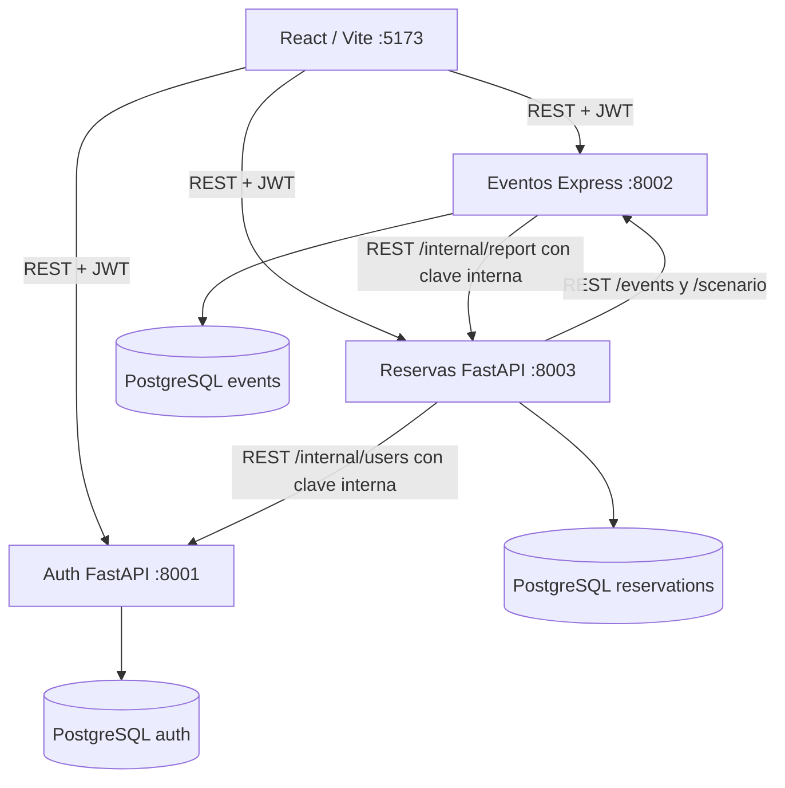
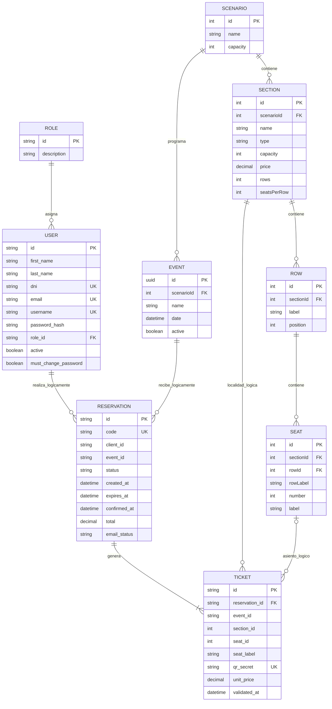

# Arquitectura y decisiones de CONCIERTA

## Componentes (microservicios heterogéneos)

Cada base de datos está aislada lógicamente y los servicios se ejecutan como procesos locales independientes. Docker se utiliza únicamente para el motor PostgreSQL. El escenario físico es único, de solo consulta y precargado al iniciar. Cada evento se asocia con ese escenario.

## Modelo entidad-relación por dominios

> **Nota:** las relaciones entre entidades de microservicios distintos son **lógicas**, no claves foráneas físicas entre bases de datos. En particular, `RESERVATION.client_id`, `RESERVATION.event_id`, `TICKET.section_id` y `TICKET.seat_id` se verifican mediante las APIs correspondientes.

### Relaciones y reglas del escenario

El modelo físico en la base de eventos es **Escenario → Sección → Fila → Asiento**. La tabla `Rows` identifica cada fila mediante `id`, `sectionId`, `label` y `position`; `Seats.rowId` es una clave foránea local hacia `Rows.id`. Se mantienen `Seats.sectionId` y `Seats.rowLabel` por compatibilidad con la API y la interfaz existentes.

El escenario precargado contiene cinco secciones: VIP (48 asientos en 4 filas), PREFERENCIA (72 en 6 filas), BUTACAS (60 en 5 filas), GENERAL (90 en 6 filas) y CANCHA (60 localidades de pie sin filas ni asientos numerados). En total son **330 localidades**: 270 asientos numerados y 60 localidades de CANCHA.

`TICKET.reservation_id` sí tiene clave foránea local hacia `RESERVATION.id`. Los demás identificadores de otros dominios no tienen claves foráneas entre bases. El servicio de reservas valida el evento y las localidades mediante REST. Un cliente corresponde a un usuario con rol `CLIENTE`, sin duplicar sus datos personales en otra tabla.

## Consistencia del inventario y las reservas

El servicio considera ocupados los asientos confirmados y las reservas pendientes **que aún no han expirado**. Cada creación adquiere un bloqueo transaccional de PostgreSQL (`pg_advisory_xact_lock(hashtext(event_id))`), consulta de nuevo la disponibilidad dentro de la transacción y valida los cupos, los asientos ocupados, los asientos repetidos y el máximo de seis entradas por cliente y evento.

La confirmación y cancelación actualizan el estado de la reserva. Las pendientes vencidas no bloquean disponibilidad; su cambio de estado a `EXPIRED` se ejecuta actualmente al efectuar determinadas operaciones del servicio. **La expiración periódica autónoma queda pendiente para la etapa 2.** Los tickets se conservan para permitir la trazabilidad de las reservas canceladas. En CANCHA, sin asientos numerados, se controla una capacidad agregada y se emite un ticket por unidad.

## Seguridad: CID, AAA y Shift Left

- **Confidencialidad:** hash de contraseñas con bcrypt, JWT firmado, secretos en `.env` y permisos basados en roles. Las credenciales y los archivos `.env` no deben incorporarse al repositorio.
- **Integridad:** claves foráneas y unicidad locales, ORM, validaciones Pydantic/Zod, bloqueo transaccional y control contra reutilización del QR.
- **Disponibilidad:** endpoints `/health`, comprobación de PostgreSQL, `pool_pre_ping` en el servicio de reservas y tratamiento de fallos del servicio de eventos con respuestas `503`.
- **AAA:** autenticación basada en JWT y flujo OAuth2 Password local; autorización por roles `ADMIN` y `CLIENTE`; trazabilidad básica mediante marcas de tiempo y estados. **La auditoría persistente y completa de accesos y operaciones sigue pendiente.**
- **DevSecOps / Shift Left:** mantener secretos fuera del código, revisar dependencias (`npm audit`, `pip-audit`), análisis estático, integración continua y pruebas de concurrencia. **La automatización integral de estos controles aún está pendiente.**

## API, interfaz y documentos

El navegador React consume directamente las tres APIs REST, sin un gateway desplegado. Esta estructura facilita el desarrollo local; para producción se recomienda un reverse proxy o gateway apropiado.

El pago es una transición de estado **simulada**, sin integración bancaria. El sistema incorpora integración SMTP para enviar credenciales y confirmaciones de reservas, con comprobante PDF general y boletos PDF individuales con QR. La entrega efectiva de correos depende de la configuración SMTP y debe verificarse con pruebas reales.

La API de escenarios conserva `Sections[].Seats` para compatibilidad con el frontend y el servicio de reservas, y añade `Sections[].Rows[].Seats` para representar la estructura jerárquica. La propiedad `rows` (número de filas) y la asociación `Rows` (colección de filas) se diferencian por mayúsculas; determinados clientes que ignoran el caso, como Windows PowerShell 5.1, requieren tratamiento especial al convertir la respuesta JSON.

## Ejecución local y persistencia

- **Frontend:** React/Vite, puerto `5173`.
- **Autenticación:** FastAPI, puerto `8001`, base `concierta_auth`.
- **Eventos:** Express/Sequelize, puerto `8002`, base `concierta_events`.
- **Reservas:** FastAPI/SQLAlchemy, puerto `8003`, base `concierta_reservations`.
- **Persistencia:** PostgreSQL en Docker; los tres servicios se ejecutan localmente en Windows.

La definición de infraestructura, las migraciones y el SQL de respaldo se mantienen en `infra/`. Los cambios de tablas existentes se aplican con migraciones; no es necesario reinicializar ni borrar el volumen de PostgreSQL.
