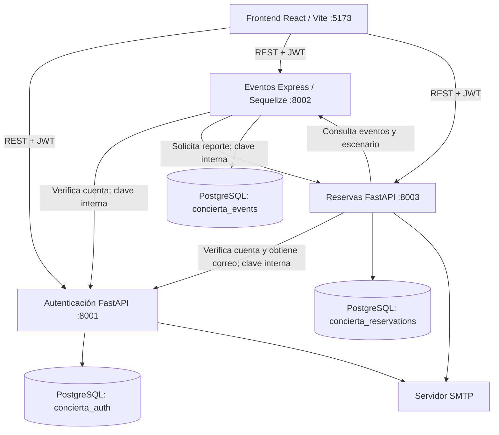
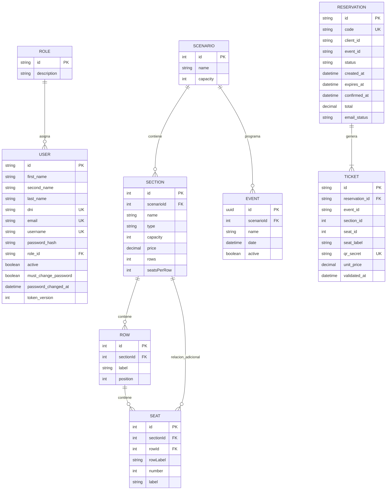

# Arquitectura y decisiones técnicas de CONCIERTA

> Proyecto académico de reservas de conciertos. Esta documentación describe la arquitectura implementada. Los diagramas ampliados están en [`DIAGRAMAS.md`](DIAGRAMAS.md) y las instrucciones de ejecución en el [`README.md`](../README.md).

## 1. Componentes y comunicación

CONCIERTA emplea **microservicios heterogéneos**, con aplicaciones ejecutadas localmente y **PostgreSQL en Docker**. La interfaz se presenta en español, utiliza dólares estadounidenses (USD) y muestra fechas para Ecuador.

No existe un gateway desplegado. El navegador accede directamente a las tres API. Cada servicio administra su propia base de datos; **no existen claves foráneas físicas entre bases**. Los servicios intercambian identificadores y comprueban la información de otros dominios mediante HTTP.

| Componente | Tecnología | Puerto | Persistencia |
|---|---|---:|---|
| Frontend | React y Vite | 5173 | Estado temporal en el navegador |
| Autenticación | Python, FastAPI y SQLAlchemy | 8001 | `concierta_auth` |
| Eventos | Node.js, Express y Sequelize | 8002 | `concierta_events` |
| Reservas | Python, FastAPI y SQLAlchemy | 8003 | `concierta_reservations` |
| PostgreSQL | Contenedor Docker | 5434 (host) | Tres bases de datos independientes |

## 2. Modelo de información por dominios

Las relaciones `User → Reservation`, `Event → Reservation`, `Section → Ticket` y `Seat → Ticket` son **referencias lógicas entre microservicios**. En Reservas, `Ticket.reservation_id` sí es una clave foránea física local hacia `Reservation.id`.

Cada servicio mantiene además su propia tabla de auditoría, independiente de las tablas de negocio. Los registros incluyen la acción, el actor, el recurso, el resultado y la fecha.

### Escenario y localidades

El escenario precargado contiene **330 localidades**, distribuidas así:

| Sección | Filas | Asientos por fila | Capacidad | Numerada |
|---|---:|---:|---:|---|
| VIP | 4 | 12 | 48 | Sí |
| PREFERENCIA | 6 | 12 | 72 | Sí |
| BUTACAS | 5 | 12 | 60 | Sí |
| GENERAL | 6 | 15 | 90 | Sí |
| CANCHA | — | — | 60 | No |
| **Total** | **21** | — | **330** | **270 asientos numerados** |

La jerarquía física de Eventos es `Scenario → Section → Row → Seat`, con la relación adicional `Section → Seat` por compatibilidad. El endpoint `/scenario` expone tanto `Sections[].Seats` como `Sections[].Rows[].Seats`. La propiedad `rows` (cantidad numérica de filas) y la asociación `Rows` (colección de filas) se distinguen por mayúsculas; PowerShell 5.1 puede producir conflictos al convertir ambos nombres JSON sin distinguir mayúsculas y minúsculas.

CANCHA controla el aforo por cantidad, sin asiento físico numerado. Cada unidad reservada genera un ticket individual.

## 3. Reservas y consistencia de inventario

1. El cliente consulta conciertos, localidades y disponibilidad.
2. Reservas comprueba que el evento esté activo y sea futuro; también comprueba la sección y los asientos con Eventos.
3. En la creación se adquiere un bloqueo transaccional de PostgreSQL por evento: `pg_advisory_xact_lock(hashtext(event_id))`.
4. Dentro de la transacción se verifica la disponibilidad actual, la ausencia de duplicados, el aforo por sección y el máximo de **seis entradas por cliente y evento**.
5. La reserva nace como `PENDING` y bloquea las localidades durante **cinco minutos** por defecto (`HOLD_MINUTES`).
6. Una confirmación a tiempo la cambia a `CONFIRMED`; la cancelación cambia su estado a `CANCELLED`. Los tickets se conservan para trazabilidad.
7. Las reservas pendientes vencidas dejan de ocupar localidades. Además de la evaluación de vencimiento en las operaciones, **existe un proceso automático en segundo plano que revisa las expiraciones aproximadamente cada 30 segundos**.

Los estados de reserva son `PENDING`, `CONFIRMED`, `CANCELLED` y `EXPIRED`. La base de datos protege las operaciones concurrentes; el frontend no constituye la autoridad final sobre disponibilidad.

## 4. Autenticación, autorización y auditoría

### Autenticación

- Contraseñas protegidas con **bcrypt**; se distribuyen credenciales temporales a través de SMTP.
- El primer acceso exige cambiar la contraseña temporal. La nueva contraseña requiere al menos 10 caracteres, mayúsculas, minúsculas y números.
- Los JWT están firmados con **HS256**, tienen expiración y contienen `token_version`.
- El cambio de contraseña incrementa `token_version`; los servicios cotejan la versión del token contra el estado actual del usuario en Autenticación.
- Las cuentas inactivas o pendientes de cambio obligatorio no pueden utilizar las operaciones protegidas.
- Un limitador básico por dirección IP reduce intentos repetidos de inicio de sesión; en la configuración local mantiene los contadores en memoria.

### Autorización

- La base de Autenticación administra los roles; los permisos de las rutas administrativas se verifican con el rol actual del usuario.
- Eventos y Reservas consultan `/internal/users/{uid}` mediante `INTERNAL_SECRET` para comprobar el estado real de la cuenta. No confían únicamente en el rol declarado por el JWT.
- Las rutas públicas y administrativas están separadas y los datos personales completos no se incluyen en la respuesta reducida de inicio de sesión.

### Auditoría

Los tres microservicios registran acciones importantes en sus respectivas tablas de auditoría:

- **Autenticación:** intentos de inicio de sesión, cambios de contraseña, operaciones de usuarios y roles.
- **Eventos:** creación, modificación y despublicación de conciertos.
- **Reservas:** creación, confirmación y cancelación de reservas, y validaciones exitosas de tickets.

Las auditorías se escriben después de la operación principal y sus errores se registran en el servicio; por ello, **no constituyen todavía una garantía de escritura atómica con la operación de negocio**.

## 5. CID, AAA y DevSecOps

| Principio | Medidas implementadas |
|---|---|
| **Confidencialidad** | Hash bcrypt; JWT; secretos de entorno; autorización por rol; respuestas de inicio de sesión reducidas |
| **Integridad** | Validación Pydantic/Zod; unicidad y claves foráneas locales; transacciones y bloqueo por evento; validación QR de un solo uso |
| **Disponibilidad** | Endpoints `/health`; comprobaciones de conexión; liberación automática de reservas expiradas; errores controlados cuando fallan dependencias |
| **Autenticación** | Credenciales individuales, JWT firmado y cambio obligatorio de contraseña |
| **Autorización** | Roles actuales, comprobación interservicios e invalidación de sesiones |
| **Auditoría** | Tablas persistentes y registro de operaciones relevantes en cada microservicio |

**Enfoque Shift Left:** se han aplicado validaciones y controles de seguridad desde el desarrollo. Durante la fase de calidad se ejecutaron **38 pruebas automatizadas con resultado satisfactorio** (16 de Autenticación, 7 de Eventos, 7 de Reservas y 8 de integración). Posteriormente se revirtieron algunos cambios del entorno de pruebas; **esa cifra corresponde al resultado histórico, no a una suite que se afirme disponible actualmente**.

La automatización permanente de CI, las auditorías periódicas de dependencias y un despliegue de producción endurecido no están acreditados como completados. No deben presentarse como implantados.

## 6. Correos, documentos y control de acceso

- **Registro:** Autenticación envía credenciales temporales mediante SMTP real. No devuelve contraseñas en la respuesta de registro.
- **Confirmación:** Reservas envía un correo con **un comprobante general PDF** y **un PDF individual por boleto**, con QR único.
- **Fallo de envío:** la reserva confirmada permanece válida; `email_status` permite identificar fallos y solicitar reenvío desde el área del cliente.
- **Descargas:** la aplicación permite obtener los documentos de las reservas confirmadas según la autorización correspondiente.
- **Validación de acceso:** el payload QR tiene el formato `CONCIERTA:<ticket_id>:<qr_secret>`. Solo el administrador puede invocar `POST /tickets/{ticket_id}/validate`; la segunda validación del mismo boleto se rechaza.

El frontend dispone de una pestaña administrativa **Validar entradas**, con lectura mediante cámara en navegadores compatibles y entrada de datos de QR como alternativa.

Los cobros son **simulados**. Los documentos emitidos son comprobantes y boletos, no facturas tributarias.

## 7. Administración y reportes

El administrador puede gestionar usuarios, roles y eventos, consultar el historial individual de reservas y tickets, y filtrar informes por fecha, evento y estado. Los informes muestran capacidad, ocupación y recaudación simulada por concierto y sección.

**Distinción de métricas:** la disponibilidad calculada en un informe filtrado a partir de reservas confirmadas no equivale necesariamente a la disponibilidad de compra en tiempo real; las reservas `PENDING` vigentes también bloquean localidades.

## 8. Ejecución local y documentación

| Servicio | Inicio en Windows (desde la raíz) | Documentación / salud |
|---|---|---|
| Autenticación | `./scripts/start-auth.bat` | `http://localhost:8001/docs` |
| Eventos | `./scripts/start-events.bat` | `http://localhost:8002/health` |
| Reservas | `./scripts/start-reservations.bat` | `http://localhost:8003/docs` |
| Frontend | `./scripts/start-web.bat` | `http://localhost:5173` |

La infraestructura y los datos semilla se mantienen en `infra/`. Los cambios del esquema existente deben conservar los datos; **no ejecutar `docker compose down -v`** para reiniciar o actualizar la aplicación.

Consulta también:

- [`../README.md`](../README.md): requisitos, instalación y operación.
- [`DIAGRAMAS.md`](DIAGRAMAS.md): diagramas ampliados de arquitectura, entidades y procesos.
- Swagger/OpenAPI de Autenticación y Reservas en los puertos indicados; Eventos documenta sus rutas Express en la documentación del proyecto.

## 9. Límites y recomendaciones para producción

CONCIERTA es una plataforma académica local. Para operar comercialmente se necesitarían, entre otros controles: HTTPS/TLS y gestión centralizada de secretos; migraciones formalizadas; limitación de peticiones compartida entre instancias; monitorización y alertas; gestión robusta de trabajos SMTP mediante cola persistente; endurecimiento de despliegue y copias de seguridad; revisión sistemática de dependencias; y pruebas de penetración e integración continuas.
