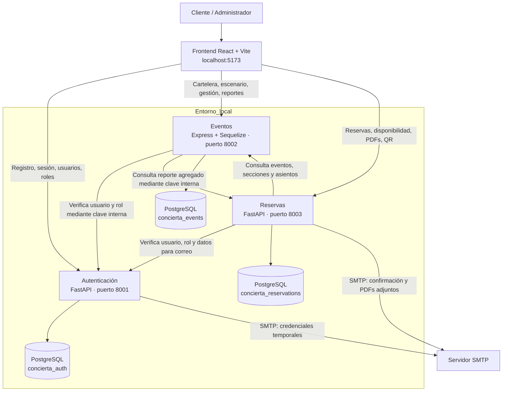
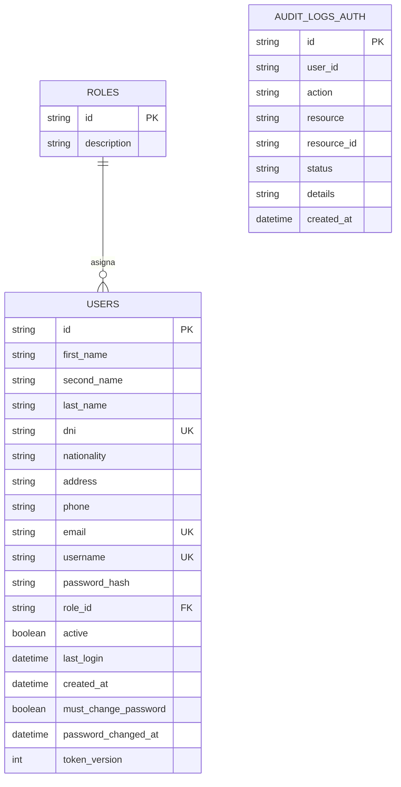
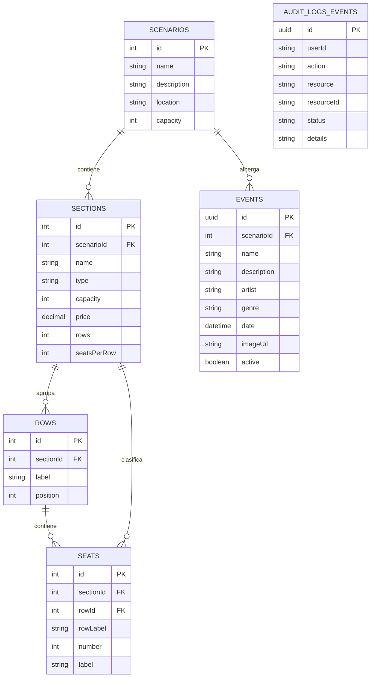
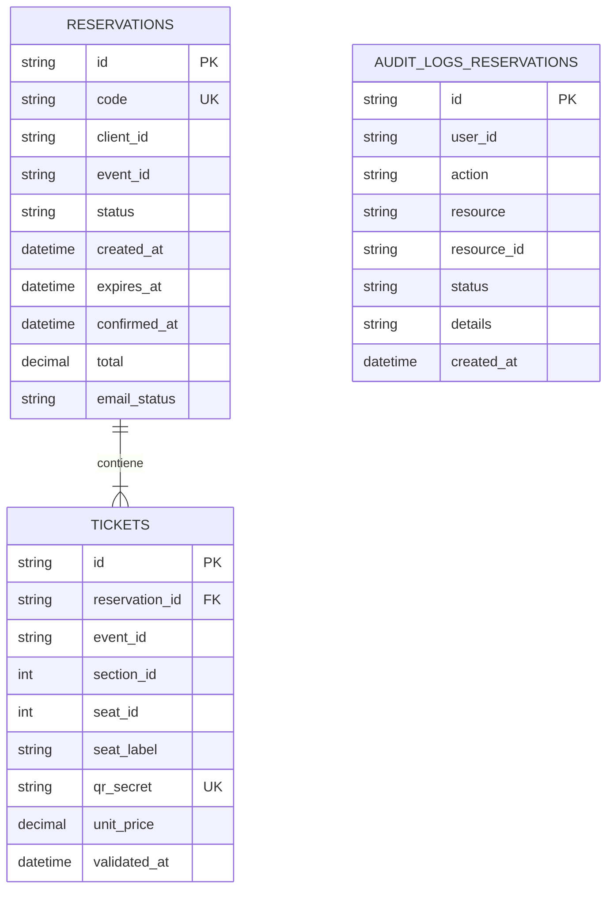
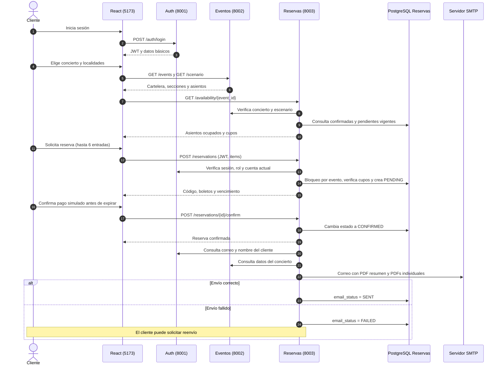
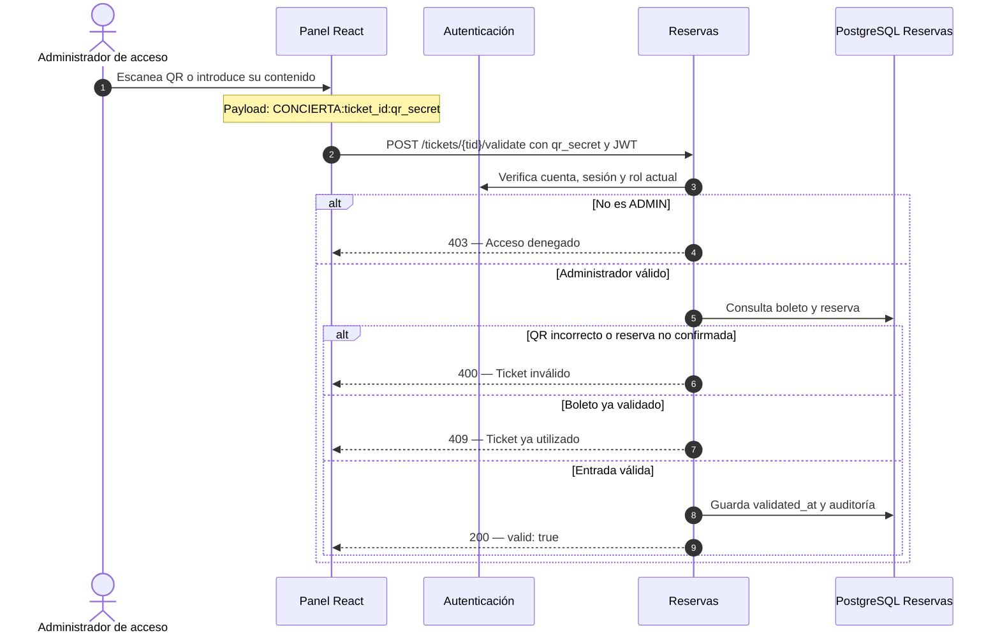

# CONCIERTA — Diagramas técnicos

**Proyecto:** Sistema académico de gestión de reservas de conciertos  
**Alcance:** arquitectura de microservicios, modelo de datos y principales flujos  
**Formato:** Mermaid (compatible con la vista previa Markdown de GitHub y editores compatibles).

> Estos diagramas describen la implementación revisada de CONCIERTA. Cada microservicio posee una base de datos PostgreSQL independiente. Las referencias entre bases son identificadores lógicos, no claves foráneas físicas.

## 1. Arquitectura general de microservicios

**Notas:**
- PostgreSQL se ejecuta en Docker; los servicios y el frontend se ejecutan localmente. El puerto PostgreSQL publicado en Windows es `5434`.
- Autenticación emite JWT; Eventos y Reservas verifican además el estado y el rol actuales del usuario mediante el endpoint interno de Auth.
- La validación QR la ejecuta un administrador; el pago es **simulado**.

## 2. Modelo entidad–relación por microservicio

### 2.1 Autenticación — `concierta_auth`

**Nota:** `AUDIT_LOGS_AUTH.user_id` almacena el identificador del actor; el código no define una relación `ForeignKey` desde esa columna hacia `users`.

### 2.2 Eventos — `concierta_events`

**Nota:** el servicio define el modelo `AuditLog` con nombre de tabla gestionado por Sequelize; los campos de auditoría se muestran para documentar su propósito. La entidad `ROW` representa las filas físicas del escenario; el atributo `sections.rows` almacena la cantidad de filas.

### 2.3 Reservas — `concierta_reservations`

**Referencias lógicas entre microservicios:**
- `reservations.client_id` corresponde a `auth.users.id`.
- `reservations.event_id` y `tickets.event_id` corresponden a `events.events.id`.
- `tickets.section_id` y `tickets.seat_id` hacen referencia a las localidades del servicio Eventos.
- No existen claves foráneas SQL entre bases de datos independientes.
- Un ticket de CANCHA puede no tener `seat_id`, al tratarse de una localidad no numerada.

## 3. Flujo de reserva y confirmación

**Reglas:**
- El apartado dura normalmente cinco minutos (`HOLD_MINUTES`). Las pendientes vencidas pasan a `EXPIRED` y liberan localidades.
- PostgreSQL serializa solicitudes competidoras del mismo evento con un bloqueo transaccional.
- La confirmación de pago no procesa dinero ni datos bancarios reales.
- Los boletos confirmados permiten descargar un PDF general y un PDF individual por entrada.

## 4. Flujo de validación de boleto QR

> **Alcance de seguridad:** el endpoint comprueba el rol, el secreto del boleto, la confirmación de la reserva y la ausencia de una validación anterior. Para despliegue comercial de alto tráfico, conviene reforzar la atomicidad de validaciones concurrentes del mismo QR mediante bloqueo o actualización condicional.

## 5. Puertos y recursos

| Componente | Dirección local | Persistencia |
|---|---|---|
| Frontend | `http://localhost:5173` | — |
| Autenticación | `http://localhost:8001` | `concierta_auth` |
| Eventos | `http://localhost:8002` | `concierta_events` |
| Reservas | `http://localhost:8003` | `concierta_reservations` |
| PostgreSQL Docker | `localhost:5434` | Tres bases independientes |

**Documentación interactiva FastAPI:** `http://localhost:8001/docs` y `http://localhost:8003/docs`. Eventos no incluye Swagger en la versión revisada.
